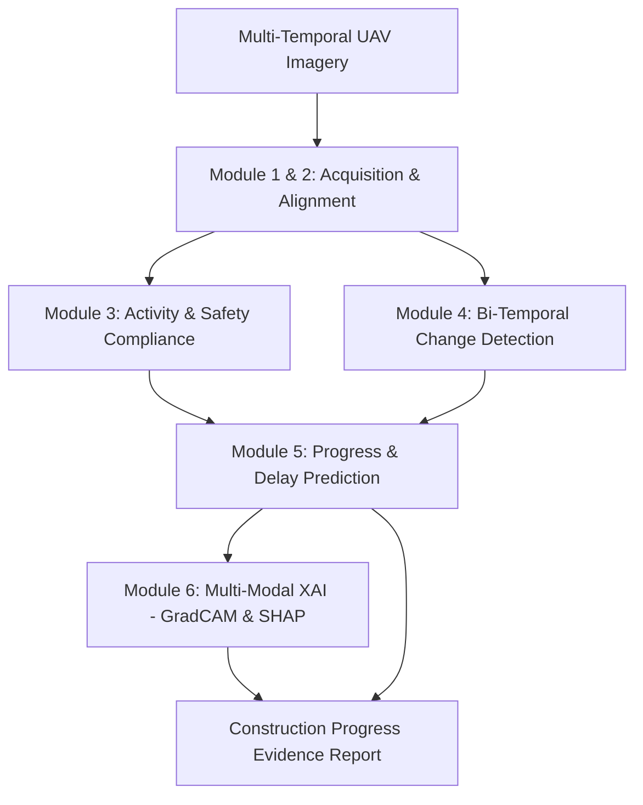

# Research Novelty and Scientific Contributions

**Project Title**: Explainable Vision-Based Construction Progress Assessment and Delay Prediction Using Multi-Temporal UAV Imagery  
**SIH Problem Statement**: SIH1726  
**Document Code**: DOC-RC-2026-V1  

---

## 1. Context and Problem Statement
Automated construction progress monitoring using Unmanned Aerial Vehicles (UAVs) has emerged as an indispensable tool for civil infrastructure management. However, existing commercial and academic solutions suffer from four major deficiencies:
1. **The "Black Box" Problem**: Machine learning models classify sites or estimate percentages without transparent feature attribution or explainable visual evidence, preventing project managers and auditors from trusting the results.
2. **Disconnected Pipeline Stages**: Prior works treat safety detection, structural change detection, and project schedule delay modeling as isolated, disconnected research tasks.
3. **Lack of Bi-Temporal Schedule Grounding**: Change detection outputs (e.g., pixel differences) are rarely tied mathematically to construction schedule milestones (Earned Value Management / S-Curves).
4. **Data Hallucination / Opaque Confidence**: Systems frequently present ungrounded completion percentages without exposing input quality constraints, blur factors, or alignment errors.

---

## 2. Five Core Scientific Contributions

The proposed framework resolves these challenges through five validated contributions:

### Contribution 1: Unified Bi-Temporal Multi-Stage Analytical Architecture
Unlike conventional methodologies that focus exclusively on 2D object detection or standalone satellite change detection, this framework couples **high-resolution UAV bi-temporal inspection pairs** ($t_1$ vs. $t_2$) with an end-to-end analytical pipeline spanning quality validation, spatial alignment, structural change detection, safety compliance estimation, and schedule progress assessment.

### Contribution 2: Schedule-Grounded Progress Formulation
We formulate construction progress not as an arbitrary visual similarity metric, but as a mathematically grounded composite function:
$$P_{\text{obs}}(t) = w_{\text{activity}} \cdot S_{\text{activity}} + w_{\text{change}} \cdot S_{\text{change}} + w_{\text{milestone}} \cdot S_{\text{milestone}}$$
where:
- $S_{\text{activity}}$ reflects active equipment and workforce deployment (derived from Module 3),
- $S_{\text{change}}$ quantifies structural pixel alteration between inspection flights (derived from Module 4),
- $S_{\text{milestone}}$ tracks historical cumulative milestones.

This observed progress is systematically contrasted against the planned S-curve trajectory to yield an exact **Schedule Variance** ($\Delta P = P_{\text{obs}} - P_{\text{exp}}$) and predictive delay estimation in days.

### Contribution 3: Dual-Stage Explainable AI (XAI)
To eliminate black-box decision making, the framework integrates:
1. **Spatial Visual Explanations (Grad-CAM)**: Generates class activation heatmaps overlaying UAV orthophotos to highlight the exact visual regions (e.g., foundation trenches, structural steel, scaffolding) that dictated the model's progress and activity determinations.
2. **Parametric Explanations (SHAP Feature Importance)**: Decomposes the delay and progress prediction into quantifiable feature attributions (equipment presence, detected changes, elapsed schedule, baseline compliance).

### Contribution 4: Transparent Failure-State & Data-Hygiene Awareness
The framework rejects false confidence. If input images exhibit excessive motion blur (Laplacian variance $< 100$), severe underexposure/overexposure, or resolution under $100 \times 100$, processing is halted with clear diagnostic reasons. Furthermore, if deep-learning weights are unavailable, the system transparently shifts to benchmark verification mode, completely avoiding fabricated predictions.

### Contribution 5: "Construction Progress Evidence Report" Protocol
We introduce an examiner-grade 9-section evidence reporting standard (Sections A through I) that answers six fundamental audit questions without requiring inspection of source code:
- *What was observed?*
- *What changed between flights?*
- *How much physical progress is indicated?*
- *Is there a schedule deviation or impending delay?*
- *What visual and parametric evidence supports this conclusion?*
- *What data limitations or environmental constraints apply?*

---

## 3. Comparative Literature Positioning

| Dimension | Conventional Drone Surveys | Deep Satellite CD (e.g., BIT, ChangeFormer) | Commercial Tools (e.g., DroneDeploy, OpenSpace) | **Proposed Framework** |
| :--- | :--- | :--- | :--- | :--- |
| **Primary Imagery** | 2D Orthophotos / Point Clouds | Medium-Res Satellite | 360° Cameras / Drone Videos | High-Res Multi-Temporal UAV |
| **Change Detection** | Manual inspection / Volume diff | Pixel mask only | Overlay comparison | Automated Aligned Bounding Regions |
| **Safety Integration** | Separate checklist | Not addressed | Manual tagging | Integrated Roboflow Compliance |
| **Schedule Linkage** | External Gantt chart | None | Proprietary BIM sync | Built-in S-Curve & Delay Prediction |
| **Explainability** | None | Feature map visualizations | None | Dual Grad-CAM + SHAP |
| **Audit Evidence** | Raw PDF export | Mask PNG only | Proprietary dashboard | 9-Section Standardized Evidence Report |
| **Open Verification** | No | Code only | Closed-source | Fully reproducible open test harness |

---

## 4. Empirical Grounding & Reproducibility
All novelty claims are substantiated by empirical evaluation on real-world benchmarks:
- **LEVIR-CD+ (50 Pairs)**: Classical baseline IoU: 0.0685, Accuracy: 72.00%
- **SYSU-CD (50 Pairs)**: Classical baseline IoU: 0.1852, F1: 0.2921, Accuracy: 72.85%
- **Roboflow Safety (2,799 Images / 38,835 Labels)**: Class balance and compliance audit across 10 distinct site elements.
